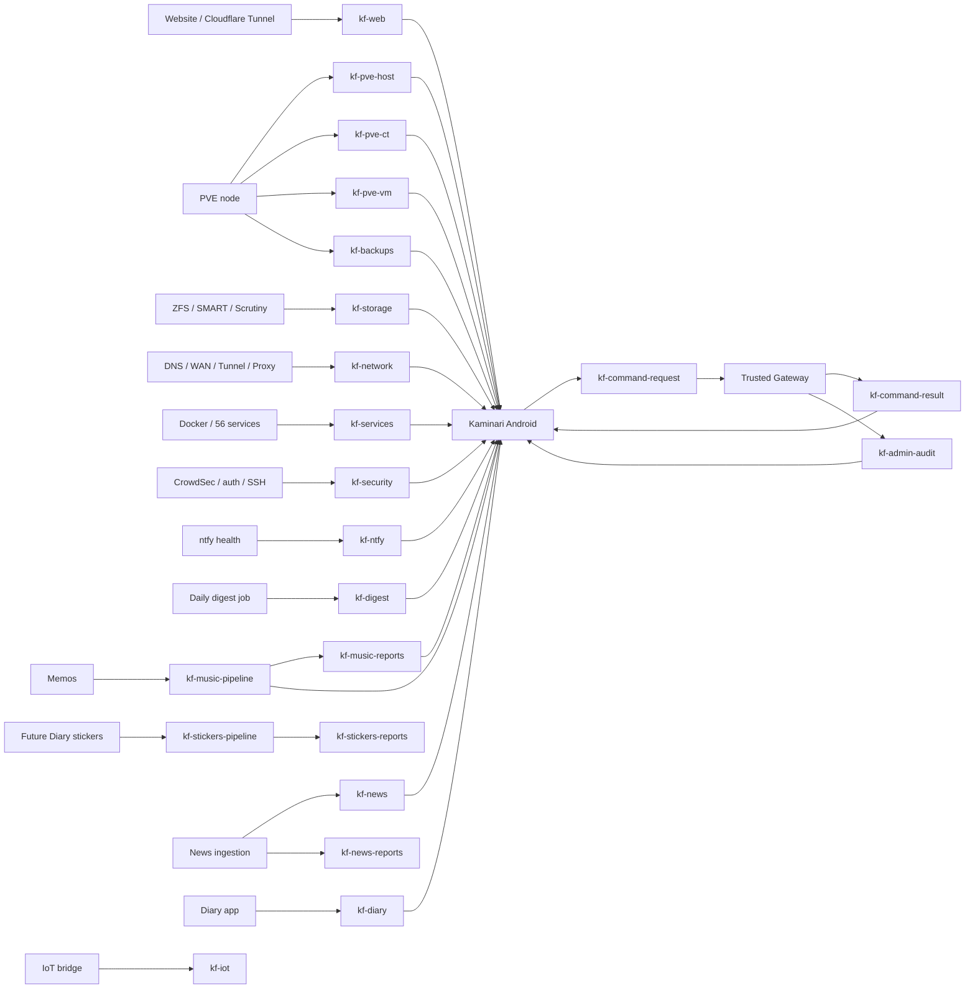

# Approved `kf-` Topic Catalogue

**Owner-approved namespace:** `kf-`
**Status:** Design locked for Freebuff implementation. **No topic was created in Stage 1.**
**Excluded by owner decision:** `kf-builds` is not part of this catalogue.

## 1. Topic catalogue

| # | Topic | Purpose | Primary publishers | Intended subscribers | Sensitivity | Expected frequency | Retention / notes |
|---:|---|---|---|---|---|---|---|
| 1 | `kf-web` | Website `rplab.qzz.io` availability, TLS, 5xx, tunnel, auth, deploy events | Website monitor / `kf_monitor` | Android app, owner | Normal | Low | 90 days |
| 2 | `kf-pve-host` | PVE node health, CPU/RAM pressure, node state, package/update events | PVE monitor / `kf_monitor` | Android app, owner | Normal | Low–medium | 90 days |
| 3 | `kf-pve-ct` | LXC lifecycle, restart, resource pressure, guest-agent state | PVE monitor | Android app | Normal | Medium | 90 days |
| 4 | `kf-pve-vm` | QEMU lifecycle, restart, resource pressure, guest-agent state | PVE monitor | Android app | Normal | Medium | 90 days |
| 5 | `kf-storage` | ZFS/SMART, capacity, scrub, pool degradation, disk health | PVE/storage monitor | Android app | Normal | Low | 90 days; critical events priority 5 |
| 6 | `kf-backups` | Backup start/result/verification, retention, restore drills | PVE/backup monitor | Android app | Normal | Low | 90 days; never include full logs |
| 7 | `kf-network` | WAN/LAN, DNS, tunnel, reverse proxy, firewall, VPN | Network monitor | Android app | Normal | Low | 90 days |
| 8 | `kf-services` | Docker/application health, restart loops, key service endpoints | Docker/service monitor | Android app | Normal | Medium | 90 days |
| 9 | `kf-security` | CrowdSec, auth failures, SSH/PVE login anomalies, firewall changes | Security monitor | Android app | **High** | Low | 90 days; no passwords or raw session data |
| 10 | `kf-ntfy` | ntfy health, restart, auth/publish failures, metrics alerts | ntfy watchdog / `kf_monitor` | Android app, owner | Normal | Low | 90 days |
| 11 | `kf-digest` | Daily infrastructure summary and quiet-hours rollup | Digest job | Android app, owner | Normal | 1/day | 30 days |
| 12 | `kf-music-pipeline` | Memos → download → metadata → library → Navidrome stage events | `kf_music` | Android app | Normal | Per run, stage-level | 30 days; aggregate noisy stages |
| 13 | `kf-music-reports` | Final per-run/batch report: requested, downloaded, skipped, failed, indexed | `kf_music` | Android app | Normal | Per run/batch | 90 days |
| 14 | `kf-stickers-pipeline` | Future Diary sticker generation/review/PNG/pack stages | `kf_stickers` (future) | Android app | Normal | Per run | 30 days; reserved, not implemented |
| 15 | `kf-stickers-reports` | Future sticker run summary | `kf_stickers` (future) | Android app | Normal | Per run | 90 days; reserved, not implemented |
| 16 | `kf-news` | News card: headline, source, category, summary, published time, image, original URL | `kf_news` | Android app | Normal | Per article / batch | 30 days; card only, not a database |
| 17 | `kf-news-reports` | Scraper run, ingestion counts, source failures, dedupe report | `kf_news` | Android app | Normal | Per run | 90 days |
| 18 | `kf-command-request` | Typed command envelope from Android/owner to gateway | `kaminari_app` | Gateway | **High** | On demand | 30 days; never shell text |
| 19 | `kf-command-result` | Correlated execution result, status, audit reference | Gateway / `kaminari_app` | Android app, owner | **High** | On demand | 90 days; no secret values |
| 20 | `kf-admin-audit` | Immutable admin/command audit events | Gateway / `kaminari_app` | Android app, owner | **High** | On demand | 1 year minimum |
| 21 | `kf-diary` | Diary application events and future sticker sync | Diary app / `kf_stickers` | Android app, owner | Normal | Low | 90 days |
| 22 | `kf-iot` | Home automation/IoT state and alerts | IoT bridge / `kf_monitor` | Android app | Normal | Low | 90 days; only if real producers exist |

## 2. Legacy topics

These are **preserved during migration** and are not deleted:

| Legacy topic | Current producer | Migration destination | Rule |
|---|---|---|---|
| `KAMINARI-FUJI-Homelab` | PVE webhook, website dashboard, Docker event watcher, MySpeed, request bot | `kf-pve-host`/`kf-pve-ct`/`kf-pve-vm`/`kf-web`/`kf-services` by event type | Migrate every producer, verify, then retire only with owner approval |
| `kaminari-diary` | `kaminari-diary` container | `kf-diary` | Keep until the diary app is migrated |
| `kaminari-onboarding-test` | Android onboarding / PVE tests | temporary test only | Do not use for production alerts |

No legacy topic is deleted merely because a replacement exists.

## 3. Separation rules

- Website events go **only** to `kf-web`.
- Host, CT and VM events stay separately addressable on `kf-pve-host`, `kf-pve-ct`, `kf-pve-vm`.
- Commands and results never mix with alerts.
- Music, stickers and news each have a pipeline topic and a report topic.
- No per-container topics; use `kf-services` with a `container` field.
- No `kf-builds`.
- `kf-digest` is a summary, not an alert channel.

## 4. Topic flow diagram

## 5. Implementation order

1. Create topic names only after authentication/ACL design is approved.
2. Move producers one domain at a time; verify each with read-back.
3. Keep legacy topics alive until all producers and subscribers are moved.
4. Only then enable `auth-default-access=deny-all` and remove anonymous access.
5. Delete legacy topics only with a separate owner approval.
