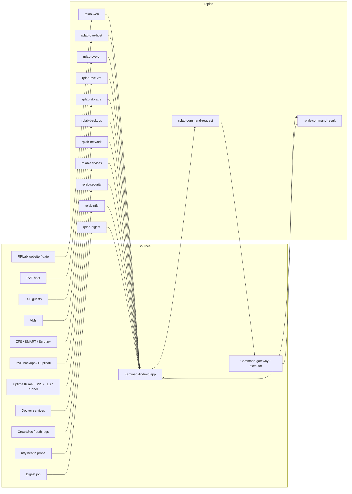

# Proposed ntfy Topic Architecture

**Status:** proposal only; no topic exists yet.  
**Namespace:** `rplab-`  
**Design rule:** separate domains by **ownership and actionability**, not by every metric or every container.

---

## 1. Principles

1. **One topic per operational domain.** A subscriber should be able to choose “backups” without receiving Docker lifecycle noise.
2. **Website is its own domain.** `rplab-web` is reserved exclusively for `rplab.qzz.io`.
3. **Host, LXC and VM lifecycle remain separately addressable.** `rplab-pve-host`, `rplab-pve-ct`, `rplab-pve-vm`.
4. **Application health is separate from guest lifecycle.** `rplab-services` is not `rplab-pve-ct`.
5. **Command traffic never shares an alert topic.** `rplab-command-request` and `rplab-command-result`.
6. **No per-container topics by default.** Use message fields (`component`, `resource`) instead of topic explosion.
7. **No destructive action buttons.** Click links open the dashboard/PVE, not execute commands.
8. **Topic names are not secrets.** Authentication and ACLs provide access control.

---

## 2. Core topic set

| Topic | Purpose | Exact events | Publishers | Subscribers | Read | Write | Priority | Retention/frequency | Separate? |
|---|---|---|---|---|---|---|---|---|---|
| `rplab-web` | RPLab website/gate only | down/recovered, 5xx burst, TLS expiry, DNS/tunnel for the site, deploy success/failure, auth outage, failed-login threshold | website monitor, deploy job, website server-side event | owner app, dashboard, Apprise | `kaminari_app`, `kfadmin`, `rplab_monitor` | site monitor/deploy identity | P5 down/TLS; P4 5xx/auth; P3 recovery/deploy; P2 info; P1 digest | Low; transitions only | **Yes — dedicated** |
| `rplab-pve-host` | PVE node health | node down, CPU/RAM pressure, root disk, load, kernel/OOM, reboot | PVE API exporter/script, Uptime Kuma | owner app | `kaminari_app`, `kfadmin` | `rplab_monitor` | P5 down; P4 pressure; P3 reboot/recovery | Low; thresholds only | Yes |
| `rplab-pve-ct` | LXC lifecycle and guest-level health | CT stopped/started/restarted, CT disk/RAM pressure, CT104 Docker disk, guest-agent unavailable | PVE API/script | owner app | `kaminari_app`, `kfadmin` | `rplab_monitor` | P4 unexpected stop; P3 normal restart; P2 info | Low; state transitions | Yes |
| `rplab-pve-vm` | VM lifecycle | VM stopped/started, VM disk/RAM pressure, guest-agent unavailable | PVE API/script | owner app | `kaminari_app`, `kfadmin` | `rplab_monitor` | P4 unexpected stop; P3 restart | Low | Yes |
| `rplab-storage` | ZFS, SMART, thin pool, capacity | pool degraded/faulted, scrub error, SMART failure, pending/reallocated growth, temperature, thin-pool free, dataset capacity | Scrutiny/InfluxDB, PVE script | owner app | `kaminari_app`, `kfadmin` | `rplab_monitor` | P5 pool/SMART failure; P4 capacity; P3 warning; P2 trend | Threshold/transition; digest for trends | Yes |
| `rplab-backups` | Backup and restore | job failed, no success in 26h, write/quota error, destination unavailable, verification failed, restore drill overdue, retention error | PVE task parser/Healthchecks, Duplicati | owner app | `kaminari_app`, `kfadmin` | `rplab_monitor` | P5 failed critical backup; P4 repeated failure; P3 success; P2 info | Low; per job result | Yes |
| `rplab-network` | WAN, DNS, tunnel, TLS | WAN down, DNS failure, tunnel down/restart, TLS expiry, cert renewal failure | Uptime Kuma, cloudflared exporter, TLS probe | owner app | `kaminari_app`, `kfadmin` | `rplab_monitor` | P5 WAN/DNS/tunnel down; P4 TLS <7d; P3 warning; P2 info | Low; transitions | Yes |
| `rplab-services` | Application health | key service down/unhealthy, DB/queue failure, OOM, restart loop, storage/queue pressure, deployment failure | Docker health/event watcher, HTTP probes | owner app | `kaminari_app`, `kfadmin` | `rplab_monitor` | P4 critical app down; P3 restart/recovery; P2 info | Medium; dedupe per service | Yes |
| `rplab-security` | Security events | SSH/PVE/ntfy auth failures, CrowdSec decisions, new exposure, privileged container, firewall drift | CrowdSec, auth log parser, config diff | owner app | `kaminari_app`, `kfadmin` | `rplab_monitor` | P5 active compromise; P4 threshold; P3 event; P2 info | Low; thresholds/cooldown | Yes |
| `rplab-ntfy` | ntfy itself | down, restart, cache loss, auth error, publish error, disk/config error, tunnel/health failure | external probe, container monitor, ntfy log parser | owner app | `kaminari_app`, `kfadmin` | `rplab_monitor` | P5 down; P4 degraded; P3 restart; P2 info | Low | Yes |
| `rplab-command-request` | Typed command requests | `rplab.command.v1` envelopes only | Android app | gateway/executor | gateway, `kfadmin` | `kaminari_app` only | P3 normal; P4 urgent (not destructive by default) | On demand; expiry 5 min | **Yes — separate** |
| `rplab-command-result` | Correlated results | accepted/rejected/executed/failed/expired with correlation ID | gateway/executor | Android app, `kfadmin` | `kaminari_app`, `kfadmin` | gateway identity only | P3 normal; P4 failure | On demand; no secrets | **Yes — separate** |
| `rplab-digest` | Daily/quiet summary | infra digest, backup summary, capacity trends, update summary | digest job | owner app | `kaminari_app`, `kfadmin` | `rplab_monitor` | P1 only | Daily at most | Yes |
| `rplab-iot` | IoT events (future) | device offline/online, sensor threshold, battery low | IoT bridge | owner app | `kaminari_app` | `rplab_monitor` | P3/P2 | Only when a real producer exists | Conditional |
| `rplab-builds` | CI/build (future) | build failed, deploy failed, release published | CI/CD | owner app | `kaminari_app` | CI identity | P3/P4 | Only when CI exists | Conditional |

**Core active set:** 13 topics (`rplab-web` through `rplab-digest`). `rplab-iot` and `rplab-builds` stay reserved until a real producer exists.

---

## 3. What not to create

| Bad pattern | Why |
|---|---|
| One topic per Docker container | 56 containers → 56 topics, impossible to manage; use `rplab-services` + `component` field |
| One topic per metric | CPU/RAM/disk each become a stream; use thresholds and digest |
| Website events in `rplab-pve-host` | Violates domain separation; the website must have `rplab-web` |
| Backups in `rplab-services` | Backup failure needs its own subscription and priority |
| Command requests in an alert topic | Commands must be isolated, typed and audited |
| `homelab-alerts` catch-all | Recreates the current overloaded topic |

---

## 4. Topic flow diagram

The Android app reads all alert topics and `rplab-command-result`; it writes only `rplab-command-request` (and the temporary onboarding test topic). The gateway reads requests and writes results.

---

## 5. Message field contract

Every event should carry these fields where possible:

| Field | Example | Purpose |
|---|---|---|
| `title` | `[BACKUP] CT104 failed · disk quota` | Human-readable, component-prefixed |
| `component` | `backup`, `pve`, `web`, `storage` | Filtering and routing |
| `resource` | `CT104`, `VM200`, `rplab-web` | What is affected |
| `severity` | `critical`, `warning`, `info` | Machine-readable severity |
| `event` | `backup.failed`, `web.down`, `zfs.degraded` | Stable event ID |
| `state` | `open`, `recovered`, `acknowledged` | State machine |
| `timestamp` | ISO-8601 UTC | Ordering |
| `detail` | short error/threshold | Actionable evidence |
| `click` | dashboard/PVE URL | Safe destination |
| `dedupe_key` | `backup:CT104` | Suppression/correlation |

Do not put credentials, tokens, full logs or message bodies in these fields.

---

## 6. Migration from the current model

1. Keep `KAMINARI-FUJI-Homelab` during migration.
2. Add `rplab-*` topics alongside it.
3. Move one producer at a time; keep the old topic until all consumers are verified.
4. Stop legacy publication only after the new topic has a successful alert/recovery cycle.
5. Retire `KAMINARI-FUJI-Homelab` only with explicit owner approval.
6. Leave `kaminari-diary` outside the infrastructure namespace.
7. Retire `kaminari-onboarding-test` after Android onboarding or restrict it with ACLs.

No topic is created or renamed in Phase 0.

---

## 7. Approval points

- Approve the 13 core topics and the two conditional topics.
- Approve separate `rplab-pve-ct` and `rplab-pve-vm`.
- Approve `rplab-web` as the exclusive website topic.
- Approve no per-container topics.
- Approve the command topic split.
- Decide whether `KAMINARI-FUJI-Homelab` is retired or kept indefinitely as a legacy topic.
