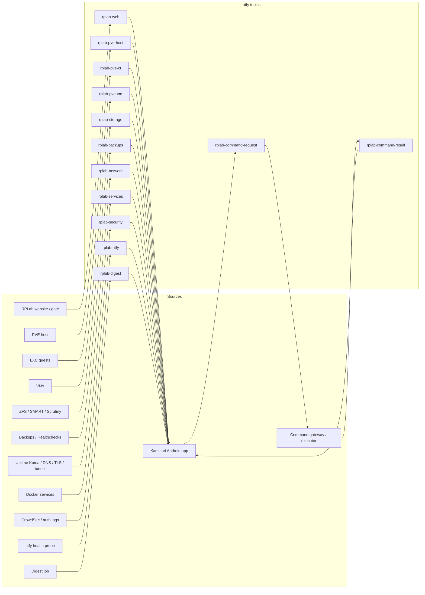

# Proposed Topic Flow Diagram

## Access direction

- Producers **write only** their own topic.
- The Android app **reads** alert topics and `rplab-command-result`.
- The app **writes only** `rplab-command-request` (and the temporary onboarding test topic).
- The gateway **reads** requests and **writes** results.
- `kfadmin` is an administrator and is never configured in the Android app.
- No producer writes to a generic catch-all topic.

## Failure-path rule

If ntfy, Cloudflare, CT104, or the tunnel is down, the monitor that reports it must not depend on the same path. Use an external Uptime Kuma/Healthchecks vantage point and a fallback channel (email/Apprise) for `rplab-ntfy` and `rplab-network` critical events.
